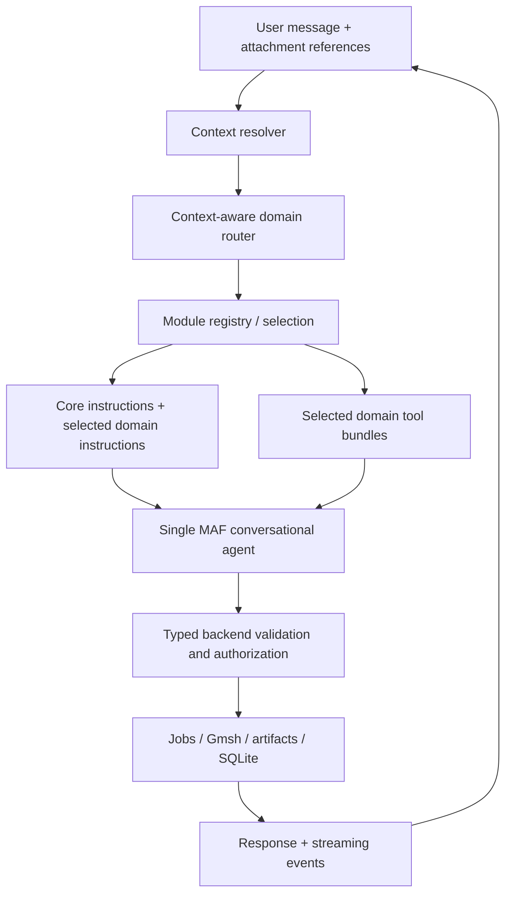

# SimAssist — Phase 11.18B.5: Modular Agent Architecture & Dynamic Tool and Instruction Loading

**Status:** COMPLETE - 2026-11-15; see [implementation report](PHASE_11_18B5_IMPLEMENTATION_REPORT.md).
**Audience:** Codex / SimAssist maintainers
**Scope:** Agent orchestration and tool/instruction organization; **not** a multi-agent rewrite
**Goal:** Keep a single user-facing Microsoft Agent Framework (MAF) agent, but load **only the domain instructions and tools required by each request**, using project/chat/engineering context to route safely.

> **Codex instruction:** Inspect repository HEAD, installed MAF version/APIs, existing agent factory, conversation context service, persistent clarification flow, tool registry, and streaming contract **before making edits**. File paths and APIs below are proposed targets, not assertions about current implementation. Preserve working behavior and use small, tested changes.

---

## 1. Motivation and design decision

SimAssist currently exposes one primary conversational agent. Its responsibilities continue to grow:

- Project and chat state; conversation memory and pending user confirmations
- CAD creation, Boolean operations, file upload/import, and geometry inspection
- Gmsh meshing, mesh revisions, quality/verification, and preview
- CAD surface picking and topology inspection
- Named selections (planned Phase 11.18C)
- Materials, loads, boundary conditions, solver setup, execution, and postprocessing (future phases)

Appending every instruction and tool schema to one monolithic agent increases prompt tokens, maintenance burden, instruction conflicts, and potentially incorrect tool selection. This is especially relevant for local models with limited context windows and VRAM.

**Decision: use a modular, domain-oriented single-agent architecture, with context-aware dynamic tool and instruction loading.**

Do **not** introduce separate LLM-powered specialist agents merely to modularize the code. Multi-agent orchestration adds calls, latency, intermediate context, and error paths. Consider it later only if measured benefits justify complexity.

### Non-negotiable principles

1. **Engineering truth belongs to deterministic backend services**, not the LLM or its summary of chat history.
2. **Agent proposes → user clarifies/approves when needed → backend validates → worker executes.**
3. Dynamic module loading is an **availability optimization**, not an authorization system. Backend services enforce project ownership, artifact validity, and tool argument validation regardless of routing.
4. Support **multiple domains in one request**; avoid a single-intent-only router.
5. Preserve existing geometry/mesh artifacts, version history, chat isolation, SSE/streaming, and pending approvals.
6. Do not re-execute historical tool calls when loading conversation context.
7. Local-first: no new mandatory cloud model, service, or subscription.

---

## 2. Target architecture



**Core instructions** remain short and always loaded: mission, project/chat boundaries, tool-use rules, clarification policy, honesty about job status, and engineering safety. **Domain instructions** are small, specific, and loaded only when relevant.

### Domain map

| Domain | Typical requests | Tool bundle / instructions |
|---|---|---|
| `geometry` | “Create an annulus”; edit/inspect CAD; Boolean cut | Geometry and CAD tools; geometry conventions |
| `meshing` | “Mesh this”; “change to quads”; “make it finer” | Mesh generation, settings/version inspection, verification |
| `cad_inspection` | Uploaded STEP; faces/edges/topology; dimensions | Import/inspection and entity query tools |
| `selections` | “Select bolt holes”; “name this face” | Surface picking/selection tools (existing and later Phase 11.18C) |
| `simulation` **future** | Material, loads, BC, solver execution | Study/solver tools added only when implemented |
| `workspace` (core or small module) | Active project, selected geometry/mesh, chat controls | Read-only context and safe workspace tools |

A module may depend on another; e.g., `selections` normally needs geometry/topology inspection tools. Make dependencies explicit in registry metadata rather than duplicating functionality.

---

## 3. Proposed code organization

Adapt these paths to the existing repository without gratuitous moves or breaking imports:

```text
backend/src/simassist/agents/
├── orchestrator.py             # Request-level construction and execution
├── router.py                   # Context-aware multi-label domain resolution
├── registry.py                 # Declarative domain metadata + dependency resolution
├── context.py                  # Read-only routing snapshot from authoritative services
├── core_instructions.md       # Small universal agent rules
├── modules/
│   ├── geometry/
│   │   ├── instructions.md
│   │   └── tools.py
│   ├── meshing/
│   │   ├── instructions.md
│   │   └── tools.py
│   ├── cad_inspection/
│   │   ├── instructions.md
│   │   └── tools.py
│   ├── selections/
│   │   ├── instructions.md
│   │   └── tools.py
│   └── simulation/              # Future, do not fabricate unsupported tools
│       ├── instructions.md
│       └── tools.py
└── tests/
    ├── test_router.py
    ├── test_registry.py
    ├── test_orchestrator.py
    └── test_agent_regressions.py
```

Keep existing domain services and tool implementations if they already have appropriate locations. The important change is **declarative bundling, small instruction sources, and request-scoped composition**; it is not an invitation to copy tools or rewrite Gmsh/worker code.

### Example registry contract (illustrative)

```python
from dataclasses import dataclass
from collections.abc import Callable

@dataclass(frozen=True)
class AgentModule:
    name: str
    instructions_resource: str
    tool_factory: Callable  # use an actual typed protocol in implementation
    dependencies: tuple[str, ...] = ()

REGISTRY = {
    "geometry": AgentModule("geometry", "modules/geometry/instructions.md", geometry_tools),
    "meshing": AgentModule("meshing", "modules/meshing/instructions.md", mesh_tools,
                           dependencies=("workspace",)),
    "cad_inspection": AgentModule("cad_inspection", "modules/cad_inspection/instructions.md",
                                   cad_tools),
    "selections": AgentModule("selections", "modules/selections/instructions.md",
                               selection_tools, dependencies=("cad_inspection",)),
}
```

The registry must **resolve dependencies, deduplicate tools, provide stable tool names, detect name conflicts, and fail clearly** on invalid configurations. Treat the example as an interface sketch, not drop-in code.

---

## 4. Dynamic tool and instruction loading

For **each new user request**:

1. Resolve authoritative `project_id`, `chat_id`, active geometry, selected mesh revision, file attachments, and any pending clarification. Do not derive these solely from conversational text.
2. Use the current message **plus resolved context** to choose one or more domains.
3. Expand explicit module dependencies and add a small always-on core capability set.
4. Compose core instructions with only selected domain instruction fragments in deterministic order.
5. Bind only selected tools to the MAF agent using the **installed MAF version's supported API**.
6. Execute with existing role-aware conversation history, token budgeting, SSE and persistence.
7. On tool results or follow-ups that require another domain, support a **bounded capability expansion** or a safe clarification/retry path. Never execute an absent tool or silently guess.
8. Return structured telemetry (selected modules, route reason, token estimates, tool calls, timings), without leaking private prompt contents to normal chat output.

**Examples**

| User request | Expected domains |
|---|---|
| “Create a 2D annulus, inner radius 1, outer radius 2.” | `geometry` |
| “Generate a quad mesh for this geometry.” | `meshing` + `workspace` |
| “Make it finer.” | `meshing` selected by current mesh + conversation context, not just keywords |
| “Inspect the uploaded STEP file and list its faces.” | `cad_inspection` |
| “Select the four bolt-hole faces and call them bolt_holes.” | `cad_inspection` + `selections` |
| “Import this STEP, mesh it, then name the loaded face.” | `cad_inspection` + `geometry` + `meshing` + `selections` as supported; preserve dependency/job order |
| “Yes, keep the same sizes.” | The domain referenced by the **persisted, chat-scoped pending proposal**, typically `meshing` |
| “What has completed?” | Core project/job inspection, not an arbitrary mutating domain |

**Important:** Router output is **multi-label**. Cross-domain messages must not be forced into one domain.

### Router design: deterministic-first, not keyword-only

Use inexpensive signals first:

- Explicit attachment types and the user message
- Existing chat-scoped pending clarification/action
- Active geometry and selected mesh metadata
- Prior conversation's recent intent (as context, not executable instructions)
- Tool capability descriptions / a curated alias map
- Request type: inspection vs mutation vs multi-step

Build a **context-aware deterministic router** with a conservative fallback. For ambiguous requests, either load a broader relevant set or ask the user; do not silently make unsafe decisions. Avoid an additional LLM classifier call on every request. Optional model-assisted fallback can be introduced **only after** profiling its value and latency, with explicit bounds and metrics.

A user must still be able to say “Can you inspect it and then mesh it?” without needing to know internal module names.

### Capability escalation / fallback

If a selected module is insufficient:

- Do not fabricate unavailable tools.
- Identify needed domain from structured tool/context information, not random attempts.
- Expand capabilities at most a configured number of times (e.g., one bounded retry), preserving job idempotency.
- Do **not** automatically repeat a non-idempotent tool action when re-routing.
- When routing remains uncertain, ask a targeted clarification question.
- Log route misses and fallbacks for later evaluation.

---

## 5. Instructions: what goes where

### Always-on core (brief)

- SimAssist identity and supported domains
- Always resolve project and chat boundaries
- Backend data and verification are authoritative
- No fabricated file paths, CAD face IDs, mesh status, units, solver results
- Clarify missing engineering parameters before mutating operations
- Distinguish proposed / queued / running / completed / failed
- Do not replay historical tool calls
- Respect user confirmations and job idempotency
- Keep responses concise, actionable, and transparent

### Domain-specific files

- `geometry/instructions.md`: primitives, STEP/OCC constraints, topology, units, Boolean behavior.
- `meshing/instructions.md`: dimensions, supported families, settings inheritance/clarification, versioning, all-quad mixed-element verification.
- `cad_inspection/instructions.md`: geometric entity semantics, faces/edges, CAD vs tessellation distinction, topology tags scoped to geometry revision.
- `selections/instructions.md`: deterministic topology lookup, ambiguity handling, selecting CAD entities rather than mesh triangles, named selection revision safety.
- `simulation/instructions.md` **future only**: units, material/BC validation, study/solver states; do not pretend these tools already exist.

**Do not** copy the same safety rules verbatim into every domain fragment; keep them in core. Test for contradictions between instructions.

### Token budget

Treat tool schemas as part of the model input footprint. Record and compare, where observable:

- Core instruction tokens
- Selected domain instruction tokens
- Tool schema tokens
- Conversation context tokens
- Total estimated input tokens
- Output tokens, if provider exposes usage

Use the current project’s existing token budget/context manager. If precise usage is unavailable, use a documented estimate and label it as such; don't invent provider usage data.

---

## 6. Microsoft Agent Framework integration

- Inspect pinned/installed MAF dependencies and the current `build_simulation_agent(...)` or equivalent factory.
- Keep a **single user-facing MAF agent per request** (or the existing managed lifecycle); dynamically pass only the required instructions/tools.
- Retain existing streaming events, exception handling, cancellation, and lifecycle cleanup.
- Do not depend on unverified hypothetical MAF APIs. If the installed version cannot replace tools on an existing agent, construct a request-scoped agent configured from the resolved registry, as the current architecture permits.
- Keep **role-aware history**, per-chat memory, pending proposals and summaries intact. Do not concatenate a fake execution trace into the current request.
- Preserve the distinction between **previous messages** (context) and **new user request** (possible tool actions).
- Ensure all tool factories use the same authoritative service dependencies and access checks.

### Suggested orchestrator pseudo-flow

```python
async def handle_request(request):
    context = await context_resolver.resolve(request.project_id, request.chat_id)
    routing = router.route(message=request.message, attachments=request.attachments,
                           context=context)
    modules = registry.resolve(routing.domains)
    instructions = compose_instructions(core_instructions, modules)
    tools = bind_and_deduplicate_tools(modules, context)

    agent = build_maf_agent(instructions=instructions, tools=tools)  # actual API: inspect repo
    try:
        return await run_with_existing_history_streaming_and_persistence(agent, request, context)
    finally:
        await close_if_required(agent)
```

This is conceptual. Reuse the existing orchestration/streaming path rather than adding a second chat runtime.

---

## 7. Security, safety and correctness

1. Every domain tool validates project ownership and immutable geometry/mesh identifiers **at execution time**.
2. Router selection **does not** grant access to files, other projects, tools, or unsafe operations.
3. User-supplied chat and uploaded CAD filenames/content are data, not routing or system instructions; handle prompt-injection attempts appropriately.
4. Persisted pending remesh confirmations are chat-scoped and cannot be used from another chat.
5. A re-route must not duplicate geometry, mesh or future solver jobs. Enforce idempotency through existing job/request semantics where possible.
6. Never treat a viewer-selected triangle as a persistent CAD face ID without valid topology mapping.
7. For multi-step actions, preserve job dependency order and wait for required artifact verification before subsequent steps.
8. Preserve behavior when context is missing, stale, or a selected geometry is deleted/soft-deleted.
9. Keep backwards-compatible API routes and SSE event contracts unless changed and migrated with frontend in the same phase.

---

## 8. Regression and evaluation suite

### Functional test matrix

| Scenario | Expected behavior |
|---|---|
| Geometry-only request | Loads core + geometry; geometry tool works |
| Mesh-only request | Loads core + meshing + context; existing geometry is respected |
| “Make it finer” with selected mesh | Correct domain resolved from context; no invented sizes |
| “Yes, keep these sizes” | Reads persisted chat-specific proposal; creates only intended job |
| STEP attachment inspection | Correct file/geometry module; project scope enforced |
| Cross-domain import → mesh | Required tools available; safe order; no duplicates |
| Surface selection / named region | Phase 11.18B tools used; Phase 11.18C capabilities remain unavailable until implemented |
| Domain route miss | Safe fallback/clarification, not a hallucinated tool |
| Two chats in one project | Isolated conversation/pending approvals; project data shared intentionally |
| Two projects | No cross-project geometry, mesh, file, or selection leakage |
| Long chat | Existing context budget and summaries continue to work |
| Streaming | Same event shape, final response and error behavior |
| Stale/deleted geometry | Validated failure; no unexpected mutation |
| Historical tool text in history | No automatic replay/duplicate job creation |

### Routing evaluation fixtures

Create a small checked-in corpus of **representative utterances with expected domain sets**, including:

- Straightforward single-domain queries
- Anaphora: “mesh it”, “make this finer”, “use that face”
- Multi-step/cross-domain tasks
- User replies to pending confirmations
- Ambiguous/no-active-geometry cases
- Unsupported solver/BC requests prior to implementation
- Negative prompts that should not trigger job submission

Compare routing precision, recall, fallback rate, latency and tool availability against the monolithic baseline. A routing error that excludes a required tool is important even when token savings look good.

---

## 9. Performance instrumentation and release gate

**Before refactoring**, capture baseline on a fixed workload covering geometry, meshing, CAD inspection, confirmation and mixed requests. **After refactoring**, rerun identical prompts and workloads on the same provider/model/settings where feasible.

Measure:

- Total instructions and tool schema bytes/tokens, with actual vs estimated usage clearly labeled
- Number of exposed tools per request
- Time for routing + agent setup
- End-to-end request latency (median and p95 when sample count supports it)
- Tool selection/routing accuracy and fallback frequency
- Job completion correctness / duplicate submissions
- Estimated local model context usage

**Do not set arbitrary promised token/latency reductions.** The gate is a meaningful reduction in irrelevant instruction/tool footprint **without regressions in accuracy, action safety, or streaming**. If performance worsens, report that and improve or roll back the router strategy.

### Observability

Create structured spans/events (Phoenix/OTEL or current observability solution where present) with:

- `chat_id`, `project_id` (appropriately handled), request ID
- Selected domains and reason codes
- Route fallback/escalation
- Tools available vs tools invoked
- Estimated prompt/schema token counts
- Routing time and completion time

Avoid recording sensitive full prompts/attachments by default. Prefer metadata and opt-in debugging.

---

## 10. Implementation sequence

### Step A — Audit and baseline

- Enumerate all existing agent instructions, tools and dependencies; identify duplicates and contradictory rules.
- Trace request lifecycle through chat endpoint, history/context builder, agent factory, tool execution and SSE.
- Add baseline routing/behavior tests and measurement harness **before** refactor.

### Step B — Extract modules without behavior changes

- Introduce registry and domain instruction fragments.
- Move tool references into domain bundles but keep the all-tools composition as a temporary compatibility mode.
- Verify output parity, test stability and no imports broken.

### Step C — Context-aware routing

- Implement typed routing snapshot and multi-domain decision logic.
- Honor pending clarifications and selected active geometry/mesh.
- Add conservative fallback and structured route diagnostics.

### Step D — Enable dynamic composition

- Build request-specific core + modules + tools.
- Resolve dependencies, deduplicate tools, validate registry and MAF binding.
- Keep safe fallback for misses; protect non-idempotent actions.

### Step E — Benchmark and harden

- Run functional and routing evaluation corpora.
- Compare token footprint, latency and correctness with baseline.
- Document module registration instructions for new domains.
- Update `ROADMAP.md`: mark this phase completed only after acceptance gates pass, then proceed to Phase 11.18C.

---

## 11. Acceptance criteria / Definition of Done

- [x] Core prompt is small and domain-independent; domain instructions live in separate resources.
- [x] A registry explicitly maps domains to tool bundles, instructions and dependencies.
- [x] Single-domain requests expose **only** core + relevant domain tools (plus declared dependencies).
- [x] Multi-domain requests can access all tools they need without fragile single-label routing.
- [x] Chat-scoped confirmation replies resolve the correct domain from persisted state.
- [x] Active engineering context is validated against backend project/geometry/mesh data.
- [x] Same MAF streaming/agent lifecycle and chat memory behavior remain intact.
- [x] No duplicate job submissions from retries, routing escalation or historical turns.
- [x] Tests cover unsupported/stale/missing context and project/chat boundaries.
- [x] Baseline vs modular prompt footprint and latency measurements are included in report.
- [x] Existing frontend build, backend tests, Ruff and Git diff checks pass.
- [x] Future `selections` and `simulation` bundles can be added without inflating every request.

---

## 12. Commands and handoff

Run from the repository root (adapt commands if tooling differs):

```powershell
uv run --package simassist-backend ruff check backend/
uv run --package simassist-backend ruff format --check backend/
uv run --package simassist-backend pytest backend/tests -q
npm --prefix frontend run build
git diff --check
git status
```

Deliver a summary of:

1. Actual current code/MAF interfaces found.
2. Changed files and responsibility of each.
3. Behavior and regression tests performed, with real pass/fail outputs.
4. Measured baseline vs modular instruction/tool token estimates and latency.
5. Known limitations/fallback scenarios.
6. Migration/backward compatibility notes.
7. Suggested conventional commit message (e.g. `refactor(agent): dynamically load domain tools and instructions`).

---

## 13. Copy-paste prompt for Codex

> Read `ROADMAP.md` and `PHASE_11_18B5_DYNAMIC_AGENT_MODULE_LOADING.md`. Implement **Phase 11.18B.5 — Modular Agent Architecture & Dynamic Tool and Instruction Loading** **before** Phase 11.18C.
>
> First inspect current repository HEAD and installed Microsoft Agent Framework APIs. Map all existing agent instructions, tools, conversation context, active engineering context, pending approvals, streaming events and job execution semantics. Establish baseline tests and token/latency measurements.
>
> Refactor toward a **single user-facing MAF agent** built from small core instructions and **request-selected domain instruction/tool bundles** (geometry, meshing, CAD inspection, existing surface selection, workspace; simulation only as a future registration point). Build a registry, multi-domain context-aware deterministic-first router, dependency expansion, safe bounded fallback and structured diagnostics. Do **not** introduce separate specialist LLM agents or a mandatory LLM router.
>
> Preserve project/chat isolation, confirmed mesh proposals, file uploads, geometry/mesh revision integrity, SSE streaming and existing backend validation. Prevent duplicate non-idempotent tool execution during retries or route expansion. Validate routing using single-domain, ambiguous, chat-follow-up, and cross-domain tests. Compare baseline and new tool-schema/instruction footprint, latency and behavior.
>
> Run Ruff, all backend tests, frontend build and `git diff --check`. Report actual results, changed files, measurements, outstanding risks, and a suggested commit. Do not implement Phase 11.18C, solver, material or boundary-condition functionality yet.

---

## 14. Roadmap placement

1. Phase 11.18A — Viewer Performance, XYZ Axes & Camera Controls
2. Phase 11.18B — CAD Surface Picking & Topology Inspection
3. **Phase 11.18B.5 — Modular Agent Architecture & Dynamic Tool/Instruction Loading (THIS PHASE)**
4. Phase 11.18C — Named Selections & Semantic Regions
5. Phase 12.0 — Simulation Studies, Units, Materials & Boundary Conditions
6. Phase 12.1 — First Real FEM Solver
7. Phase 12.2 — Postprocessing
8. Phase 12.3 — End-to-End Agentic Simulation

The phase number **11.18B.5** is deliberately inserted between B and C without renumbering prior work. Update project roadmap section accordingly after confirming its current HEAD.
