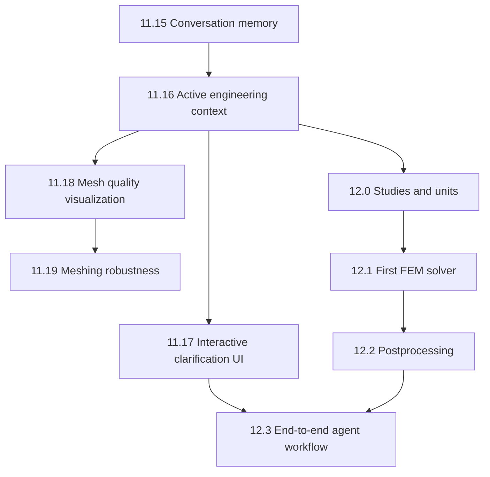

# SimAssist — Development Roadmap After Phase 11.14.1

**Audience:** Codex and project maintainer  
**Status:** Proposed, prioritized roadmap; not a claim that these features already exist.  
**Reference point:** SimAssist currently supports local-first agentic geometry creation, Gmsh meshing, persistent job/artifact tracking, VTK.js visualization, mesh versioning/quality inspection, interactive remesh clarification, projects/chats, and a unified Geometry / Mesh explorer.

> **Codex: Start by inspecting the actual repository HEAD and existing tests.** The phase numbers below are planning labels, not a mandate to invent APIs or change architecture without checking source. Keep the application runnable after each phase; prefer incremental vertical slices over speculative infrastructure.

## 1. Product vision

Build an **AI-native, local-first computer-aided engineering (CAE) workspace** that connects:

**intent → geometry → mesh → materials → physics → boundary conditions → solver → monitoring → postprocessing → verification**.

The user interacts with the system conversationally, but numerical engineering correctness is enforced by deterministic backend validation. The agent asks for missing engineering decisions instead of silently inventing parameters. Local computation and local LLM operation remain first-class; optional remote LLM providers are configurable.

### Core design principles

1. **Engineering truth lives outside the LLM.** Project context, geometry, mesh, units, jobs, and results are stored and verified by backend services.
2. **Agent proposes, user decides when ambiguous, backend validates, worker executes.** Unapproved assumptions must not silently start high-impact tasks.
3. **Each operation is versioned and inspectable.** Do not overwrite previous meshes, configurations, or simulation results.
4. **Chat sessions are isolated; projects share engineering assets.** A project can contain multiple chats and multiple simulation studies.
5. **Local-first, provider-agnostic.** LM Studio/OpenAI-compatible are supported; provider abstraction should not leak into physics logic.
6. **Reproducibility matters.** Preserve units, parameters, solver versions, input decks, logs, errors, and provenance.
7. **Protect the current working application.** Add migrations and tests; avoid destructive schema changes and mass refactors.

## 2. Current baseline (implemented or recently worked on)

| Area | Baseline |
|---|---|
| Backend | FastAPI, Python, `uv` workspace; SQLite jobs/artifact/project state |
| Agent | Microsoft Agent Framework; geometry/mesh tools; configurable LLM provider |
| Geometry | Gmsh OCC; 1D line, 2D square/rectangle/disk/annulus; 3D box/cylinder/sphere; boolean operations |
| Meshing | Gmsh; 1D lines, 2D triangles/quads, 3D tetrahedra; all-quad verification rejects mixed surface elements |
| Mesh revisions | Independent mesh jobs/artifacts attached to a geometry; historical versions preserved |
| Visualization | React + VTK.js geometry/mesh viewer, quality metrics, version selection |
| Orchestration | Async persisted jobs, worker, status events/monitoring; geometry → mesh workflows |
| UX | Projects, persistent chats, rename/soft-delete geometry; unified Geometry / Mesh tree |
| Clarification | Pending remesh proposal and confirmation; user can keep existing sizes or provide new ones |

**Known integration caveats to confirm in HEAD:** model context currently comes from concatenated recent messages (Phase 11.15 addresses this); agent may describe a geometry from only bounding boxes and misidentify an annulus as a disk; the viewer-selected mesh version may not equal the agent's latest-completed mesh choice; frontend build regressions appeared during earlier patching and must be guarded by CI.

## 3. Prioritized phases

### Phase 11.15 — Agent Conversation Memory & Context Management (NEXT)

**Deliverable:** Role-aware, per-chat durable conversation context with token budgets, incremental summaries, SSE-safe persistence, clear tool-call semantics, and verified project-state lookup.

Use the companion document: **`PHASE_11_15_AGENT_CONVERSATION_MEMORY.md`** for implementation details and acceptance tests.

**Gate:** Independent chats remain isolated; long chats work within local model context; no duplicate mesh/job submissions due to history replay.

### Phase 11.16 — Active Engineering Context & Selection Semantics

**Problem:** The viewer may display a selected *older* mesh, while the agent implicitly uses the latest successful mesh. Agent explanations sometimes conflate “no mesh discussed in this chat” with “no mesh in the project.”

**Scope:**

- Explicit project-scoped `active_geometry_id`, optional `selected_mesh_job_id`, and eventually active study ID.
- Clear UI vs backend semantics: which selection is authoritative for a tool call? Persist selection where appropriate; avoid silently changing project state from chat history.
- Backend tools `get_active_engineering_context`, `list_mesh_versions`, `get_mesh_metadata`, `get_mesh_quality`; validate referenced jobs belong to the right project/geometry.
- Accurate geometric topology metadata: distinguish **annulus (hole)** from disk; never infer topology solely from bounding box and surface count.
- Clarification UI shows actual selected version, its source geometry, dimension, family, mesh size, and units.
- Display stale/failed/queued mesh versions distinctly; don't portray a submitted job as complete.

**Gate:** Click an old Triangle v1 in explorer → agent answers explicitly which version is selected and uses it for a “remesh this version” operation *only under the documented selection policy*.

### Phase 11.17 — Interactive Engineering Forms & Validation

**Deliverable:** Structured, minimal clarification controls in UI, in addition to natural-language replies.

- Reusable confirmation payloads for mesh sizes, element family, algorithm, geometry dimension, units.
- Present existing settings and proposed changes side by side; allow **Keep**, **Edit**, **Cancel** actions.
- Render buttons only for real pending backend proposals, not synthetic UI-only approvals.
- Validate size > 0, min <= max, compatible dimensions/families, unit consistency before a job is scheduled.
- Per-chat pending proposals, expiry/cancellation when context changes, replay-safe confirmation.
- Keep chat usable without structured controls (plain-text fallback).

**Gate:** “Make the mesh finer” produces a constrained proposal; clicking confirm creates one job, clicking cancel creates none.

### Phase 11.18 — Mesh Quality Visualization & Comparison

**Deliverable:** Engineering-grade quality feedback rather than only summary numbers.

- VTK.js per-cell quality **heatmap**, legend and color scale, selectable metric by element family.
- Click/hover an element to inspect ID, local connectivity, type, and quality metric; highlight worst cells.
- Mesh comparison: triangle vs quad; versions v1/v2; cells/nodes; size distribution; quality histograms; metadata.
- Define metric formulas/ranges and any Gmsh-derived vs custom quality scores clearly. Avoid comparing non-equivalent metric scales as if identical.
- Handle 1D/2D/3D elements appropriately; do not assume surface-only meshes for all analysis.

**Gate:** An annulus with two mesh versions can display a quality heatmap and a comparison without affecting geometry/mesh files.

### Phase 11.19 — Meshing Strategies & CAD Robustness

**Deliverable:** Robust meshing workflows, particularly structured/mapped quadrilateral generation where possible.

- Separate element family, target sizing, meshing algorithm, recombination, and transfinite/mapped capabilities.
- Address Gmsh all-quad limitations: coarse recombination can yield mixed quads/triangles; verify and report rather than silently claiming all-quads.
- Optional structured annular quad strategy (e.g. suitable multi-block decomposition) **after** testing and topology-aware feasibility checks. Do not assume general topology admits all-quad with one algorithm.
- Sensible mesh sizing proposals relative to geometric scales, with explicit approval if requested sizes are missing.
- Support targeted local refinement, re-meshing provenance, deterministic meshing settings where feasible.
- Richer CAD topology validation (holes, closed volumes, manifoldness, dimension consistency).

**Gate:** Repeated annulus Triangle ↔ Quad tests with identical settings are reproducible or report transparent diagnostic reasons; prior versions remain intact.

### Phase 12.0 — Simulation Study Model & Units

**Deliverable:** First-class **Study** entity linking immutable geometry/mesh references, physical model, materials, boundary conditions, solver configuration, and results.

- Clear versioned data models and database migrations.
- Unit-aware inputs and validation (mm vs m, N vs kN, MPa vs Pa; SI/internal convention).
- Explicit geometry-to-mesh-to-study linkage; reject unrelated geometry or incompatible dimension.
- Study lifecycle: draft → validated → queued → running → completed/failed.
- Study cloning, parameter changes, and reproducibility metadata.
- Do not add dozens of unused physics fields: focus on a vertical slice.

**Gate:** A study can be created, edited, validated, and reopened after restart without initiating any solver.

### Phase 12.1 — First Real FEM Solver Vertical Slice

**Recommended initial scope:** 3D small-strain, static, linear elasticity on a simple solid beam/block, with known material parameters and displacement/force boundary conditions. Alternatively choose a simpler 2D formulation **if the selected solver supports it cleanly**. Pick one well-defined verified scenario, not a broad generic multiphysics layer.

- Evaluate local open-source solvers **CalculiX** and **Code_Aster** against Windows deployment requirements; choose a first supported path and document solver version/environment.
- Map mesh topology/node sets to solver input; explicit material, loads, constraints.
- Validate boundary-condition coverage, rigid-body modes, solver input, and units before running.
- Run solver in an isolated worker subprocess; stream progress/logs; support cancel/timeout/failure reporting.
- Store input deck, solver logs, result files, exit status, and provenance as immutable artifacts.
- Use deterministic benchmark solutions (e.g. axial bar/tension or cantilever deflection) with tolerance-based checks.

**Gate:** One end-to-end job solves a known benchmark and reproduces displacement/reaction outputs within declared tolerances.

### Phase 12.2 — Simulation Monitoring & Postprocessing

- Job timeline, stages, log streaming, error details, cancellation/retry.
- Visualize displacement magnitude/vector, deformed shape (with adjustable scale), stress fields (e.g. von Mises), reactions and mesh overlay.
- Probe/select nodes or elements, read legend values and units, export images and field data.
- Versioned results linked to exact study/mesh/solver configuration.
- Sanity checks: mesh counts, solve status, equilibrium balance, numerical warnings.

**Gate:** User asks “show displacement and maximum von Mises stress,” gets backend-computed quantities with units and viewer rendering; not LLM-estimated answers.

### Phase 12.3 — Agentic End-to-End Simulation Workflow

- Agent tools to inspect, create/edit, validate and launch studies.
- Human-in-the-loop material/BC/solver settings when not provided.
- Agent can orchestrate geometry → mesh → study → solver → postprocess, while respecting asynchronous dependencies.
- Define safe, typed tool contracts; authoritative validation and bounded agent retries.
- Concise project summaries and reproducible workflow reports.

**Gate:** A user can request a simple structural benchmark conversationally, answer targeted clarification questions, and review a verified simulation result.

### Beyond Phase 12 — Optional, not MVP blockers

- Parametric CAD and parameter sweeps/DOE.
- Optimization, surrogate models, PINN-assisted analysis and hybrid digital twins.
- Additional solvers and physics (thermal, dynamics, nonlinear contact), incremental integrations.
- Offline model selection/routing, model evaluations and latency/cost/VRAM diagnostics.
- CAD interchange STEP import/export and richer Gmsh topology workflows.
- Multi-user collaboration, permissions, external integrations only when local-first single-user workflow is mature.

## 4. Dependency order



Some work can be parallelized, but solver correctness depends on explicit units/study model; conversational automation should not precede deterministic solver validation.

## 5. Near-term backlog: defects and UX polish

- [ ] Confirm Phase 11.14.1 UI build and no runtime errors after navigation prop fix.
- [ ] Confirm unified Geometry / Mesh tree selection and version refresh after meshing.
- [ ] Fix agent reporting `no mesh yet` when completed meshes exist in the project.
- [ ] Correct annulus topology descriptions: not simply a disk, even if a bounding box resembles one.
- [ ] Avoid choosing latest completed mesh when user expects viewer-selected mesh without disclosure.
- [ ] Make missing mesh parameters explicit rather than applying coarse defaults silently.
- [ ] Preserve old mesh versions and soft-deleted geometry artifacts; make delete semantics clear in UI.
- [ ] Review empty project initialization on reload: do not create an unlimited number of unwanted projects on every browser refresh without a clear product decision.
- [ ] Guard job submission on invalid/failed geometry and mismatched dimensions/families.
- [ ] Add regression coverage for TypeScript typecheck/build (previous patch broke build despite passing syntax checks).

## 6. Architectural boundaries and data ownership

| Responsibility | Owner |
|---|---|
| Conversation turns, chat titles, chat-local summaries | Workspace/conversation repository (SQLite) |
| Active project and geometry | Project context service (SQLite) |
| Mesh version history and verified element counts | Job/artifact storage and mesh verification service |
| Pending user confirmations | Persisted chat-scoped clarification/proposal state |
| Engineering parameter/unit validation | Backend domain services |
| Tool invocation and dialogue | Microsoft Agent Framework agent |
| Geometry and meshing | Gmsh adapter/worker |
| Solver execution | Dedicated solver adapter/worker (future) |
| Visualization and user interaction | React/VTK.js frontend |

Do not let a chat summary become the only record of an engineering decision. Persist approved values in typed models.

## 7. How Codex should work on this repository

1. **Read** the current source, `pyproject.toml`, frontend build scripts, and tests before making edits; use the installed Microsoft Agent Framework API rather than guessing from online snippets.
2. Create a small implementation plan and list changed files, migrations, and behavioral compatibility risks.
3. Work on a **focused phase/branch**, preserving the current running application and demo/legacy data.
4. Write tests for each new backend contract, including failures, restarts, and persistent state.
5. Use **real frontend typecheck/build**, not merely syntax parsing.
6. Keep streaming event schema backward-compatible unless the frontend is updated in the same change.
7. Never silently generate geometry, mesh, or solver jobs from remembered text or partial proposals.
8. Document setup/restart steps for FastAPI, worker, and frontend.
9. Report precisely which commands passed/failed and what was not tested.
10. Propose a concise conventional commit per phase.

### Suggested validation commands

```powershell
uv run --package simassist-backend pytest backend/tests -q
npm --prefix frontend run build
git diff --check
git status
```

If present, run Ruff and project-specific integration tests too. Never claim tests passed without running them.

## 8. Definition of done for each phase

- Feature works end-to-end through real API and UI where relevant.
- Previously persisted projects, chats, geometries, mesh versions, and artifacts remain usable.
- New APIs are typed, validated, and tested.
- Agent can state clearly whether a job is **proposed, queued, running, completed, or failed**.
- No unexplained background job submission; no accidental repeated execution from history.
- Local/offline workflows still work; no new required cloud subscription.
- Tests/build pass, known limitations are documented, and Git history is clean.

## 9. First Codex prompt

Copy/paste the following into Codex after adding the companion Markdown file to the repository:

> Read `PHASE_11_15_AGENT_CONVERSATION_MEMORY.md` and `SIMASSIST_NEXT_STEPS_ROADMAP.md`. Inspect the actual repository, the installed Microsoft Agent Framework version, and the Phase 11.14 workspace/chat implementation. Implement **only Phase 11.15** first. Keep all existing geometry/mesh jobs, SSE behavior, chat routes, and clarification flows backward-compatible. Do not concatenate history into a user prompt. Use role-aware messages with a configurable context budget and additive SQLite persistence, plus tested long-chat summarization/fallback. Add tests for chat isolation, streaming persistence, model context limits, and no re-execution of historical tool calls. Run backend tests and frontend build; show a file-by-file summary, test results, migration notes, and unresolved risks. Do not start later roadmap phases without approval.
