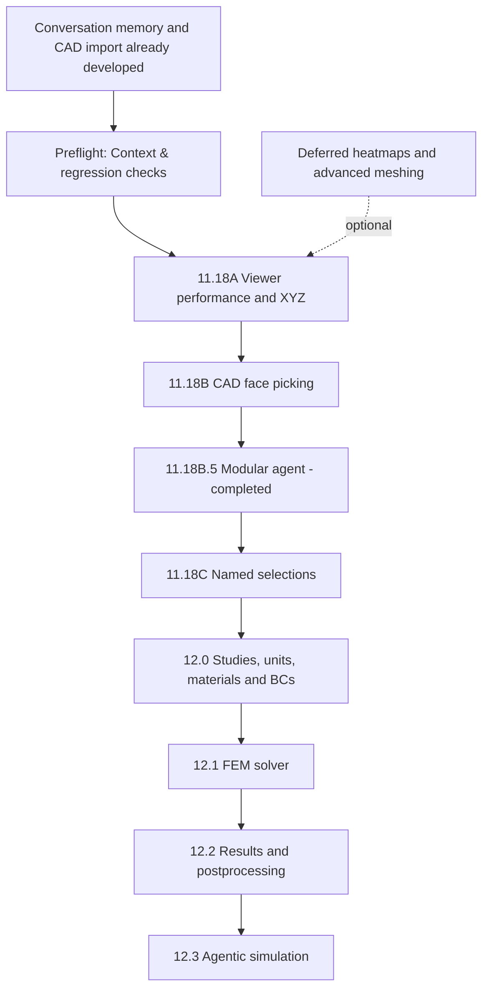

# SimAssist — Product & Engineering Roadmap

**Status:** Updated plan for Codex — 2026-11-15
**Primary objective:** Evolve SimAssist from local-first AI-assisted CAD/meshing into a reliable, interactive FEM engineering workspace.
**Current focus:** Viewer performance, engineering navigation, persistent CAD face selection, and the first real solver workflow.

> **Codex instruction:** Read the repository at its current HEAD before implementation. This roadmap identifies priorities and acceptance criteria; it does **not** claim that an item is complete just because a module or an API exists. Preserve existing users' projects, conversations, source CAD, mesh versions, and jobs. Ship each phase as a tested, end-to-end vertical slice.

## 1. Product vision and principles

A local-first, AI-native CAE workflow:

**User intent → CAD geometry → inspection → meshing → selections → material/loads/BCs → solver → results → verification.**

- **Backend owns engineering truth.** The LLM interprets requests and asks questions; deterministic code validates units, geometry references, job states, solver parameters, and numerical outputs.
- **Human-in-the-loop when necessary.** Never guess unknown units, selected CAD faces, load direction, or a high-impact setting without a defined default/approval policy.
- **Stable references and reproducibility.** Version geometry, meshes, named selections, studies, solver input decks, solver outputs, and provenance.
- **Local-first.** Offline mesh/solver workflows must work without requiring cloud services; keep model-provider abstraction separate from engineering services.
- **Fast interactive visualization.** CAD inspection should not require a completed FEM mesh. Rendering a large mesh should not block the rest of the application.
- **Agent context is explicit.** Selected geometry/mesh/study is identified by backend-validated IDs, not guessed from the chat or just the latest job.

## 2. Existing baseline and current verification status

The recently supplied backend-source snapshot includes these components; UI/runtime completion must still be verified against the current repository:

| Capability | Status / evidence to verify in HEAD |
|---|---|
| FastAPI + `uv`, persistent SQLite jobs/artifacts, background worker | Existing baseline |
| Gmsh geometry/meshing: 1D, 2D tri/quad, 3D tetra; Boolean and annulus | Existing baseline |
| Independent mesh versions and quality summary | Existing baseline |
| React + VTK.js geometry/mesh viewer, Project Explorer, chat | Existing baseline |
| Persistent projects, chats, remesh clarifications | Existing baseline |
| Role-aware conversation/context budgeting | `simassist/conversations/{context_service,budget,summary}.py` present; verify behavior/tests |
| CAD file upload and inspection | `simassist/api/routes/files.py`, `simassist/files/` present; verify end-to-end |
| CAD geometry preview | Previously developed; verify import → preview → viewer for STEP, including complex planar faces |
| Mesh selection synchronized with agent | **Needs an explicit integration/regression check** |
| 3D viewer performance at ~120k tetrahedra | **Needs profiling**; not yet established where latency occurs |
| XYZ axes / camera shortcuts | Planned; inspect whether already implemented before adding |
| CAD face picking / named selections | Planned; inspect existing topology metadata and preview mappings |
| Simulation studies / FEM solver / field visualization | Planned; do not assume solver exists based on placeholder module |

**Historical phase numbering note:** An earlier roadmap called Active Engineering Context **11.16**, while a separate implementation specification also used **11.16** for File Upload & CAD Import. Treat those names as historical references; do not rename already completed work or rewrite Git history. Use the **new 11.18A/B/C milestones** below as the next unambiguous work items, after confirming outstanding active-selection/clarification issues.

## 3. Immediate preflight — engineering context and regression hygiene

**Goal:** Establish a trustworthy starting point before adding CAD selection.

- Verify that frontend-selected geometry and mesh version are reflected correctly in backend engineering context; distinguish **selected**, **latest completed**, **queued**, and **failed** mesh versions.
- Verify chat-scoped confirmation state, isolation between conversations, and safe replays (one approval → at most one job).
- Verify STEP imports in 3D and 2D: solid counts, faces, holes, slots, units, topology and preview. Do not infer hole-free geometry from its bounding box.
- Check that fresh project creation does not produce unlimited empty projects on every browser refresh.
- Capture a performance baseline using a real ~120k tetrahedral-cell test mesh.
- Add/maintain CI-equivalent commands: Ruff, backend tests, TypeScript build.

**Exit gate:** Existing workflows remain functional; selected engineering context is unambiguous; performance measurements are recorded. Address any blocking regression before starting 11.18B.

## 4. Phase 11.18A — Viewer Performance, XYZ Axes & Camera Controls — **NEXT**

**Outcome:** Large 3D models remain navigable, and users understand the spatial orientation of every view.

### A. Performance measurement first

Instrument separately:

1. `.msh` read/parse time (backend).
2. Surface extraction and preview generation time (backend).
3. Cache hit/miss and serialized response size.
4. HTTP transfer time and browser parse time.
5. vtk.js geometry allocation, first render, and interaction frame rates.

Measure cold and warm loads on at least a **~120k-tetrahedral-element mesh**. Record hardware, browser, file size, visible face/edge counts and timings. Do not assume 120k tets means 120k visible triangles or that GPU draw time is the bottleneck.

### B. Prioritized fixes, driven by the measurements

- Extract/render **external boundary faces** for volume meshes rather than every interior tetrahedral face (preserve volumetric data separately for FEM/results).
- Cache mesh previews by immutable artifact ID + extraction/format version; invalidate only when underlying artifact changes.
- Deduplicate nodes, use indexed geometry and compact typed arrays; evaluate binary transfer versus JSON **with measurements**, not assumptions.
- Run expensive extraction outside the request hot path (job/precompute/background worker if needed).
- Avoid React remounts, repeated preview downloads and unnecessary vtk.js pipeline recreation on UI changes.
- Make mesh edge visibility optional; support a *surface-only* mode for large models.
- Preserve progress/loading/error feedback, cancellation/abort of stale requests, and UI responsiveness.
- Keep backend-generated preview metadata consistent with actual geometry and cell counts.

### C. Orientation and navigation UX

- Add camera-linked, color-coded **X/Y/Z orientation triad** (with a consistent convention).
- Add standard views: **+X, -X, +Y, -Y, +Z, -Z**, Fit to View, Reset Camera; consider a ViewCube if simpler controls are insufficient.
- Provide orthographic/perspective toggle if practical and document default camera behavior.
- Ensure axes/widgets remain correctly oriented for 1D, 2D, and 3D geometry, in both Geometry and Mesh modes.
- Retain selection/highlight state across camera changes where appropriate.

**Acceptance tests / exit gate**

- A representative ~120k-tet mesh loads and is interactively navigable; report before/after cold/warm timings and observed limitations. Do not invent a universal time or FPS target without target hardware.
- No repeated full parse/render when switching an unrelated UI panel.
- XYZ triad updates with camera rotation; standard view buttons and Fit/Reset work after resize and mode switches.
- Rendering retains existing geometry/mesh selection and mesh versioning; no change to `.msh` artifacts.

**Non-goals:** Heatmap, per-element quality histogram, new solver physics.

## 5. Phase 11.18B — CAD Surface Picking & Topology Inspection

**Outcome:** A user can click a visible CAD face and identify exactly **which surface** they mean, as a prerequisite for loads and boundary conditions.

### Backend / data model

- Preserve **CAD face provenance** during STEP/OCC import and preview tessellation. Each preview triangle must map to its owning CAD face in the corresponding immutable geometry revision.
- Expose project/geometry-scoped face metadata: stable geometry artifact/revision reference, OCC/Gmsh face tag as a *local tag*, area (with units), bounds, geometric type where available, and a representative normal where meaningful.
- Model face identity as `(geometry_revision_id, cad_face_key)` or an equivalent validated reference. **Never persist only a bare Gmsh tag as a universal stable identity.**
- If a geometry changes or reimports, **do not silently reuse old face IDs**. Mark references stale and require reassignment or a verified remapping algorithm.
- Keep CAD-face selection separate from individual mesh cell selection. Mesh boundary-cell-to-face mapping can be added for applying FEM loads later.
- Validate file ownership/project scope and protect endpoints from cross-project references.

### Viewer / interaction

- Implement vtk.js picking for CAD preview cells with `triangle/cell → CAD face` mapping.
- Highlight the *entire CAD face*, not only the one tessellation triangle clicked; support hover, click, clear selection, and multi-select if simple to implement reliably.
- Show a **Surface Inspector**: geometry revision, face label/ID, area, units, normal information/limitations, and selection count.
- Optionally display surface numbers as toggleable labels; avoid flooding the viewport on complex geometry.
- Selection must work without generating a tetrahedral FEM mesh and across viewer camera/mode changes.
- Surface normals may vary over curved faces; don't present a single vector as the global normal field of an arbitrary curved surface.

### Agent integration

- Add typed, read-only tools to inspect selected faces and list faces on active geometry.
- Support prompts like **“Which surface did I select?”** with authoritative backend metadata.
- When user says “apply a load to this face” without an explicit, valid face selection, ask for clarification—do **not** use guessed face numbers.

**Acceptance tests / exit gate**

- Import a STEP block, pick its top face, rotate/reload, and retrieve the **same face within that geometry revision**.
- Pick a hole's cylindrical wall and a planar outer face on a more complex model; distinguish the two correctly.
- Verify a 2D planar face is selectable without confusing 2D surface interior with volume-mesh boundaries.
- A different geometry/project cannot claim another model's face ID; stale revisions are rejected visibly.

## 5.5. Phase 11.18B.5 - Modular Agent Architecture and Dynamic Loading - **COMPLETED**

Completed 2026-11-15. One request-scoped MAF agent now receives core plus selected
domain instructions/tools through a deterministic context-aware multi-label router
and dependency registry. Chat-scoped proposals, role-aware memory, request replay
handling, project/revision validation and SSE behavior are preserved.

Validation: 225 backend tests, Ruff and frontend build pass. The 54-case routing
corpus has no missing required tools. Average estimated instruction/schema
footprint is 6,420 to 2,614 tokens; final local live median is 9.933 to 8.450 s
(six cases per mode; mixed workflow remains slower). All intended live jobs
completed without duplicates. Earlier slower runs and measurement limits are
retained in the [implementation report](PHASE_11_18B5_IMPLEMENTATION_REPORT.md)
and [benchmark data](benchmarks/agent-1118b5.json).

Safe fallback asks for clarification and never automatically replays actions.
This completes the architecture phase; it does not mark missing CAD face-picking
tools complete or implement named selections, materials, BCs or solvers.
Phase 11.18C and subsequent phases remain outside this implementation.

## 6. Phase 11.18C — Named Selections & Semantic Regions

**Outcome:** Convert temporary picked faces into reusable engineering regions.

- Create/edit/rename/delete project/study-associated **named selections** (e.g. `fixed_support`, `loaded_face`, `bolt_hole_walls`).
- Initially support groups of **CAD faces**; extend to edges, vertices, mesh node/element sets only when needed.
- Persist references as geometry-revision-scoped typed entities; validate that all members belong to the same expected revision.
- Show selection groups in the explorer and overlay their highlights in the viewer.
- Add agent tools `list_named_selections`, `inspect_named_selection`, and optionally propose creation with user confirmation.
- Define handling for remeshing (CAD selection persists if CAD revision unchanged) versus geometry revision changes (mark stale, prompt to repair).
- Prepare mapping from CAD face selections to boundary mesh facets/node sets for the solver; preserve/verify tags through Gmsh meshing instead of relying on geometric proximity alone.

**Acceptance tests / exit gate**

- User picks two faces, saves `fixed_support`, restarts SimAssist, and can inspect/highlight the same CAD faces.
- Remeshing the *same CAD revision* does not invalidate the named CAD-face selection.
- Replacing the CAD revision does not silently attach `fixed_support` to unrelated faces.

## 7. Phase 12.0 — Simulation Studies, Units, Materials & BC Model

**Outcome:** Reproducible, typed **Study** objects built on a selected geometry revision, compatible mesh version, material, boundary selections, loads and solver settings.

- Study lifecycle: `draft → validated → queued → running → completed/failed` (with cancel semantics as needed).
- Explicit unit system and safe conversions (mm/m, N/kN, Pa/MPa/GPa). Never assume STEP model dimensions or pressure units silently.
- First physics scope: **3D small-strain, linear static elasticity** with a single isotropic material, displacement constraints and surface force/traction/pressure.
- Typed material properties: Young's modulus, Poisson's ratio (and density later where needed).
- BCs and loads reference **named selections / validated CAD face references**, not arbitrary viewer triangle indices.
- Validate vector direction, pressure convention (inward/outward), force-vs-traction distinction, and solver-compatible units.
- Map selected CAD faces to actual boundary mesh faces/nodes; report missing/nonmatching regions explicitly.
- Study revision records exact geometry, mesh, selection set, materials, BCs, solver configuration and provenance.
- UI: simple study editor and readable summary; agent asks for only the missing essential fields before job submission.

**Exit gate:** Save, reopen, validate and clone a study after restart **without executing a solver**; reject incompatible mesh/geometry, missing units or stale selections.

## 8. Phase 12.1 — First Real FEM Solver Vertical Slice

**Outcome:** One validated structural benchmark executes end-to-end with a real numerical solver.

- Compare local Windows deployment feasibility of **CalculiX** and **Code_Aster**; choose one supported route and record exact installation/runtime expectations. Avoid committing to both at once.
- Export correct solver mesh/connectivity, face/node sets, material, loads and constraints into an input deck.
- Start with a small **cantilever/block or axial bar** linear elasticity benchmark; specify analytical/reference displacement, reaction equilibrium and numeric tolerance.
- Worker subprocess isolation, timeout, cancel, exit codes, streamed logs and reproducible artifact storage.
- Validate constraints against rigid-body motion, load selection coverage, pressure direction, and solver input syntax before scheduling.
- Preserve job/revision links: source STEP, mesh version, study revision, solver executable/version, input deck, output, logs and warnings.

**Exit gate:** A known benchmark produces credible numeric displacement and reactions within predeclared tolerances; failures are actionable and no LLM estimates masquerade as solver results.

## 9. Phase 12.2 — FEM Postprocessing & Results

**Outcome:** Interactive exploration of **backend-computed** FEM fields in VTK.js.

- Displacement vector and magnitude; undeformed/deformed geometry and adjustable deformation scale.
- Stress tensor and von Mises field, correct association with nodes/cells/integration points; legends and units.
- Probe results by node/element and named region; highlight maxima and selected boundary conditions.
- Mesh overlay, camera controls, result selection by immutable study/job revision.
- Export images and data files; provenance, warnings, result-status checks, equilibrium checks where practical.
- Keep field conversion/averaging rules explicit; do not imply nodal stress is directly computed if it is extrapolated/averaged.

**Exit gate:** “Show displacement and maximum von Mises stress” returns numerically computed values and a correctly labeled viewport, with exact study/result provenance.

## 10. Phase 12.3 — Agentic End-to-End Simulation

**Outcome:** Conversational orchestration of the complete verified pipeline.

- Agent retrieves active engineering context, selected/named CAD faces, compatible mesh and study state via read-only inspection tools.
- User can ask: “Fix this face, apply 100 N downward on that face, assign steel, and run a static simulation.”
- Agent clarifies face identity, direction, units, missing material properties and solver assumptions instead of inventing them.
- Backend stores typed proposal; user approves; worker executes validated study; agent reports job status accurately.
- Async dependencies and retries cannot duplicate jobs; chat history cannot inadvertently replay tool actions.
- Post-run report provides exact loads, BCs, mesh, solver version, numerical outputs, validation status and file links.

**Exit gate:** A user uploads a STEP part, picks support/load surfaces, gives a natural-language simulation request, approves the setup, and inspects a verified displacement/stress result end-to-end.

## 11. Deferred backlog — not blocking first FEM solver

- **Mesh Quality Heatmap & Comparison (formerly 11.18):** per-cell heatmap, histogram, element picking and mesh version comparisons; keep existing quality summary/validation in place.
- Advanced meshing/CAD robustness (formerly 11.19): mapped/transfinite quad support, targeted refinements, topology repair, large STL remeshing and mesh import extensions.
- ViewCube polish, measurement/distance/angle tools, section clipping, exploded views, annotations.
- Parametric CAD, parameter sweeps, optimization, surrogate/PINN workflows and hybrid digital twins.
- Additional solver/physics modules: thermal, dynamics, nonlinear material/contact.
- Advanced local model routing, memory/performance telemetry, multi-user collaboration.

**Reprioritize deferred items only if a concrete benchmark or user workflow is blocked by them.**

## 12. Dependency / delivery sequence



The first three milestones can be kept narrow; **do not wait for a full CAD workstation UI before developing one verified solver case**.

## 13. Codex implementation workflow and guardrails

1. Inspect current repository, tests, dependency versions, and the specific route/viewer/job components before editing. Map existing APIs first.
2. Make a short phase-specific plan and implement **one phase at a time**. Don't combine 11.18A, 11.18B and solver integration in one PR.
3. Keep database migrations additive and preserve existing project/chat/mesh/STEP artifacts.
4. Put topology and selection validation in backend services. No geometry/mesh data ownership in the LLM's message text.
5. Keep chat/session and project boundaries explicit, including multi-chat pending proposals and stale selection handling.
6. Keep existing job/event API backwards-compatible unless updating consumers in the same change.
7. Write unit/integration tests for numerical geometry mapping, cross-project rejection, invalid/stale references and restart persistence.
8. Run real frontend type checking and Vite build, not only syntax parsing. Test actual WebGL behavior in a browser for viewer phases.
9. Report what was actually measured and tested, versus what still requires the user's Windows/GPU environment.
10. Commit in small, reviewable changes; include migration/rollback notes when relevant.

### Validation commands from project root

```powershell
uv run --package simassist-backend ruff check backend/
uv run --package simassist-backend ruff format --check backend/
uv run --package simassist-backend pytest backend/tests -q
npm --prefix frontend run build
git diff --check
git status
```

If Ruff isn't available in the environment, use `uvx ruff` or add it as a dev dependency; do not silently skip checks. For performance phase, additionally record browser Network and Performance timings and backend extraction timings.

### Definition of Done (every phase)

- Works through the actual backend API and frontend where applicable; not only through mocks.
- Builds and tests pass, with exact commands and pass/fail results reported.
- Existing geometry/mesh/chat/project/file features remain usable after restart.
- Engineering references are validated by project, geometry revision and mesh version.
- The interface clearly distinguishes selected, proposed, queued, completed and failed states.
- No numerical/physics values fabricated by an LLM.
- Performance claims are supported by reproducible measurements; limitations are documented.

## 14. Ready-to-paste Codex task — Phase 11.18A

> Read `ROADMAP.md` and inspect the current SimAssist codebase (particularly Gmsh mesh preview extraction, preview routes, frontend VTK.js viewer, and existing mesh/version state). Implement **only Phase 11.18A: Viewer Performance, XYZ Axes & Camera Controls**. Start with instrumentation of a ~120k-tetrahedral-cell mesh and measure backend parse/extraction, transfer, browser parse and first rendering. Make bottleneck-driven improvements (external surface-only preview, preview caching, compact transfer, optional edges as needed), add camera-linked XYZ orientation and standard view/Fit/Reset controls, and preserve selection/version behavior. Don't implement CAD face picking, mesh quality heatmaps or solver integration yet. Add tests, run Ruff/backend tests/frontend build, and report before/after performance numbers and remaining limitations. Preserve all existing artifacts and database state.
