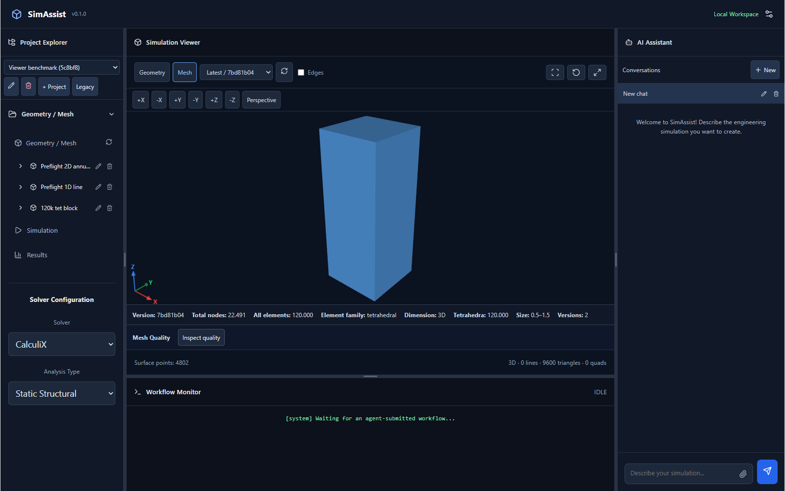

# Phase 11.18A: viewer performance, XYZ axes and camera controls

Implemented only the Section 3 preflight corrections and Section 4 viewer phase.
No CAD face picking, named selections, heatmaps or solver features were added.

## Immediate preflight

| Check | Finding before this phase | Result |
| --- | --- | --- |
| Active geometry | Already persisted and project-validated | Preserved |
| Viewer mesh versus agent mesh | Viewer version was frontend-only; agent inspected latest completed mesh | Fixed: additive `selected_mesh_job_id`, validated selection API, reload restoration and selected/latest tool fields |
| Queued/failed mesh versions | Viewer already listed completed versions; workflow monitor owns execution state | Preserved; selection API rejects incomplete/foreign versions and wrong geometry revisions |
| Chat isolation/confirmations | Native role-aware history and chat-scoped proposals already implemented | Regression checks pass: no job before confirmation, one after approval, replay/cross-chat confirmation rejected |
| 3D STEP import | Upload, units, import, previews, meshing and versions already implemented | Existing real Gmsh integration tests pass |
| Planar STEP holes/slots | Not explicitly covered by import regression tests | Added import/preview test: planar face with a circular hole and slot; centroid/area checks preserve both cutouts |
| Empty project refresh | Already reuses empty untitled projects with atomic startup | Existing tests pass, including empty auto-created chats and concurrent startup |
| Viewer bottleneck | Already extracted exterior faces, but read 3D meshes twice and looped over all tetrahedral faces in Python | Measured before optimization; timings below |

Selection remains project-scoped; conversation messages/proposals remain chat-scoped.
`get_active_mesh_info` reports `selected_mesh` independently of
`latest_completed_mesh`. Remesh proposals retain the existing latest-completed
baseline and disclose it. Changing active geometry clears the remembered mesh;
reselecting the same geometry preserves it. Explorer and viewport version
highlights follow the saved selection. No jobs/artifacts are rewritten.

## Implementation

- Vectorized face grouping and multiplicity remove internal tetrahedral faces.
  Normals are oriented outward only for boundary triangles. Corners of
  higher-order tetrahedra retain the previous linearized display semantics.
  Indexed node compaction, lines and quads remain supported; invalid indices,
  repeated corners and non-manifold faces are rejected.
- One `.msh` read per cold extraction. Disposable version-2 preview JSON and
  sidecar metadata live beside the immutable artifact. Cache identity includes
  artifact UUID, extractor version and source file stat fingerprint; SHA-256
  detects corrupted cache bytes. Atomic writes, per-artifact thread exclusion,
  short Windows filenames and rebuild-on-corruption protect reuse. Ownership
  checks happen before cache lookup. Cross-process duplicate cold builds are
  safe, although not serialized across worker processes.
- New verified mesh jobs precompute previews in the existing worker before
  completion. Optional cache failure cannot invalidate a verified mesh. Older
  artifacts build once on demand in the existing synchronous endpoint/threadpool.
- Warm responses return cached JSON bytes directly, bypassing recursive
  `jsonable_encoder` traversal. Existing preview URLs/body fields remain valid.
  `Server-Timing` exposes parse/extraction/serialization/cache timings;
  `X-Preview-Cache` and response bytes distinguish cold/warm paths.
- The browser validates/cache-bounds immutable project/artifact URLs (estimated
  32 MiB parsed-data budget); the VTK scene retains at most two datasets and
  camera snapshots. GPU buffers are separate from that estimate. Camera,
  resize, edge and quality controls never rebuild mesh geometry or download it.
  Geometry-only VTK registration also reduces the production bundle from about
  1.66 MB to 1.29 MB before compression.
- Surface-only mesh rendering is the default; **Edges** enables wire overlays.
  Quality analysis now starts with **Inspect quality**, not during mesh loading;
  reopening an unchanged report reuses it. The numerical quality algorithm is
  unchanged and can still be expensive for large meshes.
- Right-handed camera-linked triad: **X red, Y green, Z blue**, with projected
  labels. Standard **+X/-X/+Y/-Y/+Z/-Z**, **Fit to view**, **Reset camera**,
  fullscreen and orthographic/perspective toggle work in both modes.
  New 3D datasets default to perspective/isometric with +Z up; 1D/2D default to
  orthographic +Z looking toward the XY plane, with +Y up. Fit preserves the
  orientation/projection; Reset restores that dataset's default. Mode switches
  restore cached per-dataset camera settings.

## Measurements

Measured 2026-11-15 on Windows 11 build 26200, Intel Core i7-12700H,
Python 3.14.3, NumPy 2.5.4, meshio 5.3.5, vtk.js 38.0.7 and headless
Microsoft Edge 157.0.4341.60. WebGL used **ANGLE/SwiftShader software rendering**.
This tests actual WebGL, not the user's physical GPU/interactive desktop session.

Fixture: a deterministic conforming tetrahedral block stored as a real binary
Gmsh 2.2 `.msh`, 3,989,855 bytes; **120,000 tetrahedra / 22,491 source nodes**.
Its external boundary has **9,600 triangles / 4,802 points / 14,400 unique edges**.
This is a reproducible data-size fixture, not an industrial CAD performance claim.

Before implementation, the unmodified path measured **10.573 s first / 10.435 s
repeat**, with no preview cache. Detailed historical-source instrumentation and
production-browser measurements are retained in
[the numerical benchmark record](benchmarks/viewer-1118a.json).

| Stage | Before | After |
| --- | ---: | ---: |
| `.msh` parse per cold build | 116.1 ms across 2 reads | 51.9 ms, 1 read |
| Boundary extraction | 10,573.5 ms | 211.1 ms |
| JSON serialization | 4.0 ms | 5.5 ms |
| Cold backend build/cache path | 10,689.6 ms plus serialization | 277.6 ms |
| Warm backend derived cache | Repeated full build (9,877.6 ms) | 30.6 ms first disk hit / 1.2 ms repeat |
| Browser Mesh-click to displayed surface, cold derived cache | 14,405.6 ms | 515.9 ms |
| Browser mode switch back to the same mesh | 14,559.2 ms | 67.0 ms, no HTTP or parse |
| New page, warm backend cache | Not separately instrumented before | 133.9 ms; HTTP cache HIT |

The browser's cold HTTP response reported 351.2 ms total server work (including
106.4 ms parse / 236.0 ms extraction under the HTTP process), about 19.6 ms body
reading, 0.9 ms JSON parse and 2.5 ms validation. VTK allocation and render
submission are separately captured in the JSON record; rendering is CPU
submission time, and the first-frame callback is not a GPU-fence measurement.

A real mouse-orbit test with edges enabled and the viewport resized recorded
approximately **57 VTK animation frames/s** over 1.3 seconds, no JavaScript
errors, and triad direction matching the main camera. This is the SDK animation
estimate in a short software-rendered run, not a display FPS guarantee or a
universal performance target. Before-interaction FPS was not instrumented.

Cold means **derived preview cache absent**, not a flushed operating-system disk
cache. Browser tests use production builds and actual HTTP to an isolated API,
not mocked mesh payloads. Before/after samples are individual reproducible runs,
not a statistical hardware benchmark. The old UI also eagerly requested quality
analysis, competing for CPU while loading; the new UI defers that work.

Compact float32/index buffers were evaluated: 172,824 bytes versus 232,563 bytes
of preview JSON (about 26% smaller, excluding binary framing/metadata), and
3.8 ms packing in the fixture. JSON parsing was already under 1 ms, while
extraction dominated. A binary protocol was therefore deferred; the source
coordinate/volume data was not quantized or changed.



## Validation and reproduction

Passed: **142 backend tests**, full `ruff check backend/`, full
`ruff format --check backend/`, frontend TypeScript/Vite build, and eight real
WebGL browser regression groups. Browser checks cover six directions, camera
rotation/triad agreement, projection/fit/reset, edges, resize, fullscreen, quality
panel isolation/reuse, older-version selection across mode changes/reload, and
1D/2D/3D geometry/mesh rendering, and project-switch resource cleanup. Source mesh bytes are hash-checked unchanged in
cache tests. Frontend lint exits successfully with React warnings; Vite retains
its bundle-size advisory.

`git diff --check` passes for implementation changes. The user's separately edited
roadmap retains existing Markdown trailing spaces on lines 3-4; it is not staged
or rewritten by this phase.

From the workspace root, generate/profile an isolated fixture:

```powershell
.venv/Scripts/python.exe scripts/benchmarks/viewer_benchmark.py --generate-only
git show e94a06efa5a19277233b02eecfd55923bb4cc4f6:backend/src/simassist/api/routes/mesh_previews.py | Set-Content .benchmarks/viewer-1118a/legacy_mesh_previews.py
.venv/Scripts/python.exe scripts/benchmarks/viewer_benchmark.py --legacy-source .benchmarks/viewer-1118a/legacy_mesh_previews.py
.venv/Scripts/python.exe scripts/benchmarks/viewer_benchmark.py
.venv/Scripts/python.exe scripts/benchmarks/viewer_fixture.py --root .benchmarks/viewer-1118a/server
```

The fixture server uses port 8002, creates its own database/artifacts only under
`.benchmarks`, and refuses roots outside that directory. It supplies verified
120k-tet mesh versions plus native 1D/2D geometry/mesh fixtures. The normal
application `data/` directory is never opened. The fixture's cache-reset endpoint
exists only in this test server, not the production app.

In a **dedicated test terminal**, build the frontend against that isolated API
and serve it on port 4175 (close this terminal afterwards so its environment
settings are not used for normal development):

```powershell
$env:VITE_API_URL='http://127.0.0.1:8002'
$env:VITE_API_BASE_URL='http://127.0.0.1:8002'
npm.cmd --prefix frontend run build -- --outDir ../.benchmarks/viewer-1118a/optimized-frontend
npm.cmd --prefix frontend run preview -- --host 127.0.0.1 --port 4175 --strictPort --outDir ../.benchmarks/viewer-1118a/optimized-frontend
```

In another terminal, run sequentially:

```powershell
$env:VIEWER_URL='http://127.0.0.1:4175'
npm.cmd --prefix frontend run benchmark:viewer
npm.cmd --prefix frontend run test:viewer
```

Playwright uses the installed Windows Edge browser; no browser download is
needed on this setup. For historical browser measurements, build a separate
checkout of the recorded baseline commit, point its API URLs at the same fixture
server, serve it on 4174, start the fixture with `--baseline`, and run
`node frontend/e2e/viewer-benchmark.mjs --baseline` with `VIEWER_URL` set to 4174.
Raw timings/screenshots are generated under ignored `.benchmarks/viewer-1118a`.

Append `?viewerDebug=1` to the app URL to receive read-only
`simassist:viewer-performance` browser events for transfer/parse/validation,
scene allocation, first-frame callbacks, camera direction and interaction rates.
Nothing is transmitted to a telemetry service. Backend cache headers remain
visible in the browser Network panel.

## Migration, rollback and remaining limits

Restart **API and worker**, then refresh the frontend. The one additive SQLite
column is nullable; existing geometry selection and all messages/jobs/artifacts
are preserved. Older code can ignore that column on rollback. Derived v2 caches
are disposable; older builds ignore them. No `.msh` or STEP file is rewritten.

Physical GPU/browser-driver behavior still needs validation in the user's normal
Windows session. Complex industrial CAD and substantially larger boundaries may
behave differently; the existing 300,000 preview-cell guard remains. Quality
analysis is still CPU-bound when requested. Multiple API processes can duplicate
a first cold extraction, but their atomic cache writes are safe. Multi-tab
selection uses the last validated project selection; transactional user/study
editing is outside this phase. These are limits, not evidence of new solver or
CAD-face-selection support.
